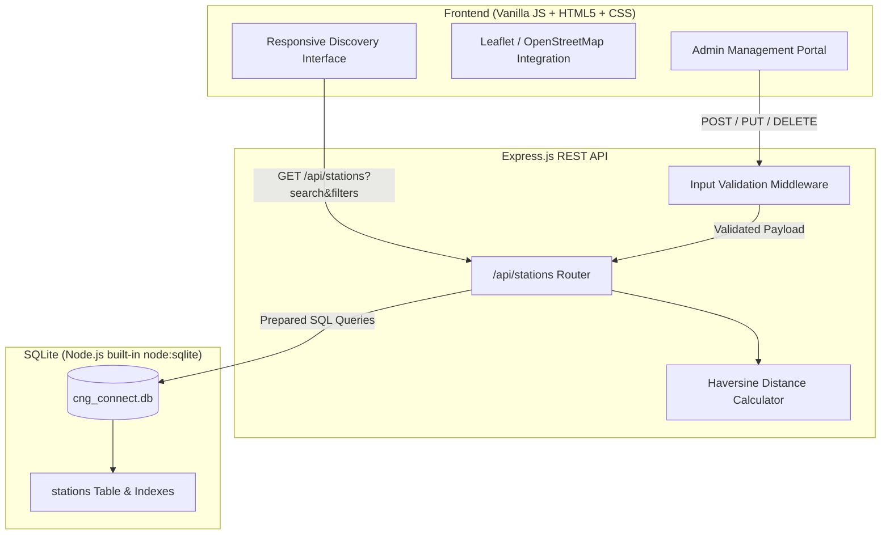
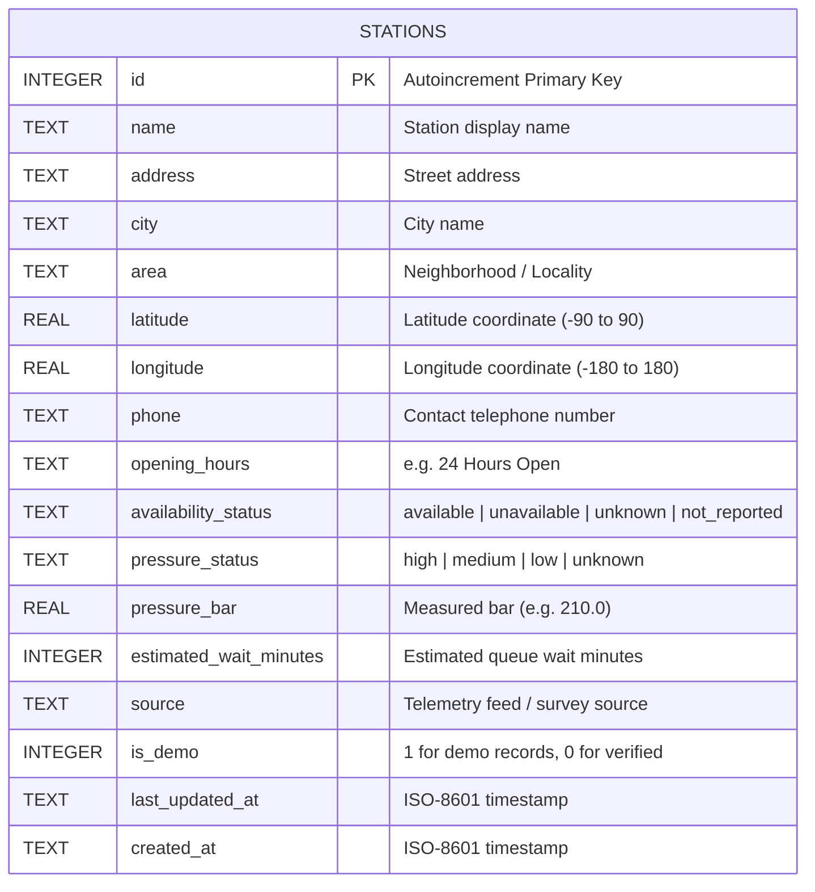

# CNG Connect — CNG Station Discovery, Comparison & Management Platform

[]()
[]()
[]()

> **Core Objective:** Help CNG drivers find and compare nearby CNG stations using operational telemetry (distance, availability, pressure, and estimated waiting time) while giving authorized administrators an interface to maintain verified station records.

---

## 📑 Table of Contents

1. [Problem Statement & Ethical Data Transparency](#1-problem-statement--ethical-data-transparency)
2. [Architecture & System Flow](#2-architecture--system-flow)
3. [Database Schema & ER Diagram](#3-database-schema--er-diagram)
4. [REST API Documentation](#4-rest-api-documentation)
5. [User Authentication & Authorization (Admin & Operator Access)](#5-user-authentication--authorization-admin--operator-access)
6. [Multilingual Grounded Assistant](#6-multilingual-grounded-assistant)
7. [Quickstart & Installation](#7-quickstart--installation)
8. [Testing & Verification](#8-testing--verification)
9. [Usage Guide & Demonstration Walkthrough](#9-usage-guide--demonstration-walkthrough)
10. [Sprint Plan & Role Delivery](#10-sprint-plan--role-delivery)

---

## 1. Problem Statement & Ethical Data Transparency

CNG vehicle drivers routinely face long queues, unexpected station closures, or low-pressure compressors that prevent full tank refills. Standard generic map apps list stations as points of interest without distinguishing whether gas is currently dispensing or what the queue is.

### Core Transparency Rules Applied in CNG Connect:
- **No Fabricated Availability:** Stations without live telemetry are labeled `unknown` or `not_reported`. Missing data is never converted into a positive claim.
- **Distance Transparency:** Straight-line distances computed via the Haversine formula are explicitly marked as **"Straight-line estimate"** (never misrepresented as road driving distances).
- **Stale Telemetry Warnings:** Records with timestamps older than 4 hours display a visible `⚠️ Stale Data` warning badge.
- **Sample vs. Verified Tagging:** All sample data records in demo mode carry a transparent `Sample Demo` indicator.

---

## 2. Architecture & System Flow



---

## 3. Database Schema & ER Diagram



---

## 4. REST API Documentation

Base URL: `http://localhost:3000/api`

### 1. List Stations
- **Method:** `GET /api/stations`
- **Query Parameters:**
  - `search` (string): Search station name, area, or city.
  - `city` (string): Filter by specific city (e.g., `New Delhi`, `Mumbai`, `Pune`).
  - `availability` (string): `available`, `unavailable`, `unknown`, `not_reported`.
  - `pressure` (string): `high`, `medium`, `low`, `unknown`.
  - `maxWait` (number): Max estimated wait minutes.
  - `userLat` & `userLng` (numbers): User GPS coordinates to compute straight-line distance.
  - `sortBy` (string): `distance`, `wait_time`, `pressure`, `availability`, `last_updated`, `default`.
- **Response `200 OK`:**
  ```json
  {
    "success": true,
    "count": 15,
    "filters": { "search": null, "city": null, "sortBy": "default" },
    "data": [
      {
        "id": 1,
        "name": "IGL CNG Mother Station - Connaught Place",
        "city": "New Delhi",
        "area": "Connaught Place",
        "latitude": 28.6315,
        "longitude": 77.2167,
        "availability_status": "available",
        "pressure_status": "high",
        "pressure_bar": 215,
        "estimated_wait_minutes": 12,
        "distance_km": 1.2,
        "distance_type": "straight_line_estimate",
        "source": "Sample Demo Dataset — IGL Regional Feed",
        "is_demo": true,
        "last_updated_at": "2026-10-12T16:10:00.000Z"
      }
    ]
  }
  ```

### 2. Single Station Detail
- **Method:** `GET /api/stations/:id`
- **Query Parameters:** `userLat`, `userLng` (optional)
- **Response `200 OK` / `404 Not Found`**

### 3. Create Station (Admin Operation)
- **Method:** `POST /api/stations`
- **Body:**
  ```json
  {
    "name": "HPCL CNG Station - Bandra",
    "address": "Linking Road, Bandra West",
    "city": "Mumbai",
    "area": "Bandra",
    "latitude": 19.0596,
    "longitude": 72.8295,
    "phone": "+91 22 2640 1234",
    "opening_hours": "24 Hours Open",
    "availability_status": "available",
    "pressure_status": "high",
    "pressure_bar": 210,
    "estimated_wait_minutes": 15,
    "source": "Admin Verified Entry",
    "is_demo": 1
  }
  ```
- **Response `201 Created` / `400 Bad Request` (with detailed error array on invalid input)**

### 4. Update Station
- **Method:** `PUT /api/stations/:id`
- **Response `200 OK` / `404 Not Found` / `400 Bad Request`**

### 5. Delete Station
- **Method:** `DELETE /api/stations/:id`
- **Response `200 OK` / `404 Not Found`**

### 6. Reset Demo Dataset
- **Method:** `POST /api/stations/reset-demo`
- **Response `200 OK`:** Restores default sample seed dataset for hackathon reproducibility.

### 7. Health & Platform Metadata
- `GET /api/health` — System status and total records.
- `GET /api/stations/meta/stats` — Operational metrics (available count, stale counts).
- `GET /api/stations/meta/locations` — Distinct cities and areas.

### 8. Multilingual AI Chatbot Endpoints
- `GET /api/chat/languages` — Returns supported languages (English, Hindi, Marathi, Gujarati, Spanish, French, German).
- `POST /api/chat` — Conversation endpoint:
  ```json
  {
    "message": "Which station has high pressure in Pune?",
    "language": "hi",
    "userCoords": { "latitude": 18.5314, "longitude": 73.8553 }
  }
  ```
  Returns natural language grounded reply, telemetry metrics, and direct station recommendation cards.

### 9. User Authentication & Favorites Endpoints
- `POST /api/auth/register` — Create a new user profile (`name`, `email`, `password`, `role`, `phone`, `vehicle_type`).
- `POST /api/auth/login` — Login with email and password, returns 30-day session token.
- `GET /api/auth/me` — Protected profile retrieval with favorite station IDs.
- `POST /api/auth/logout` — Invalidate session token.
- `GET /api/auth/favorites` — Retrieve list of favorited stations for authenticated user.
- `POST /api/auth/favorites/:stationId` — Save station to favorites.
- `DELETE /api/auth/favorites/:stationId` — Remove station from favorites.

---

## 5. User Authentication & Authorization (Admin & Operator Access)

Station creation, modification, deletion, and demo resets are restricted through token-based authentication and role-based access control.

### Default Demo Credentials & Roles:
| Account | Email | Password | Role | Permissions |
|---|---|---|---|---|
| **System Administrator** | `admin@cngconnect.in` | `Admin@123` | `admin` | Full CRUD, reset demo dataset, platform telemetry management |
| **Station Operator** | `manager@igl.in` | `Manager@123` | `operator` | Station record editing, pressure and wait-time updates |
| **Driver** | `driver@cngconnect.in` | `Driver@123` | `driver` | Read-only discovery, favorites management (station mutations return `403 Forbidden`) |

---

## 6. Multilingual Grounded Assistant

An integrated, floating assistant is built directly into CNG Connect to help drivers make fast refueling decisions in their native language:

- **7 Supported Languages:** 🇬🇧 English, 🇮🇳 हिन्दी (Hindi), 🇮🇳 मराठी (Marathi), 🇮🇳 ગુજરાતી (Gujarati), 🇪🇸 Español, 🇫🇷 Français, 🇩🇪 Deutsch.
- **Strict Database Grounding:** Responses are linked directly to local SQLite station records—answering queries about reported pressure (bar), availability status, estimated wait times, and straight-line proximity without fabricating live IoT sensor feeds or pretending unconfigured external AI microservices exist.
- **Voice Input (Speech-to-Text):** Integrated with the browser's Web Speech API so drivers can speak hands-free.
- **Direct Station Actions:** Station cards referenced inside responses include one-click inspection buttons that open the Station Profile modal directly.
- **CNG Safety Guidelines:** Built-in safety knowledge covering engine shut-off, hydrostatic cylinder 3-year compliance, and passenger evacuation during refueling.

---

## 7. Quickstart & Installation

### Prerequisites
- Node.js v20+ (developed and tested on Node.js v24.21.0)
- npm

### 1. Install Dependencies
```bash
npm install
```

### 2. Seed Database
```bash
npm run seed
```
*(Populates SQLite `data/cng_connect.db` with 15 verified & sample demo stations across Delhi-NCR, Mumbai, and Pune, along with test user accounts).*

### 3. Start the Server
```bash
npm start
```

Open `http://localhost:3000` in your web browser.

---

## 8. Testing & Verification

The automated test suite runs using Node.js's native test runner (`node:test`) and tests positive, negative, and edge cases across the API, validation layers, and authentication:

```bash
node --test --test-concurrency=1 tests/api.test.js tests/auth.test.js
```
*(Alternatively: `npm test`)*

### Test Coverage Highlights (32 Tests Passing):
- ✅ **API Health Check:** Verifies database connectivity and record counters.
- ✅ **Station Listing & Search:** Validates filtering by name, area, city, and demo status.
- ✅ **Query Parameter Validation (Negative):** Rejects invalid coordinate pairs, out-of-bounds coordinates, negative wait times, and invalid sort/filter options.
- ✅ **Straight-Line Distance Calculation:** Tests Haversine algorithm accuracy and coordinate bounds from user GPS coordinates.
- ✅ **Station Details by ID:** Validates station lookup, rejecting non-integer, negative, or zero IDs with 400.
- ✅ **Input Validation (Negative):** Verifies that missing required fields return `HTTP 400` with descriptive error lists.
- ✅ **Coordinate Bounds (Negative):** Strictly rejects invalid latitudes (`> 90` or `< -90`) and longitudes (`> 180` or `< -180`).
- ✅ **Explicit Telemetry Transparency:** Verifies that missing wait times and unverified pressures remain explicit `null` and `unknown` without fabrication.
- ✅ **CRUD Operations & Role-based Authorization:** End-to-end `POST`, `PUT`, and `DELETE` lifecycle; prevents unauthorized mutations by driver role (`403 Forbidden`) while permitting admin.
- ✅ **User Authentication & Session Lifecycle:** Login, registration, session invalidation, and favorite station management.
- ✅ **Telemetry Freshness Stats:** Verifies platform metric calculations and stale record counters (>4h).
- ✅ **Multilingual Chatbot & Voice Assistant:** Validates language discovery, English and Hindi responses, input sanitization, and voice intent action dispatch (`TOGGLE_MAP`, `NAVIGATE`).

---

## 9. Usage Guide & Demonstration Walkthrough

Follow these 9 steps during project evaluation:

1. **Discovery & Search:** Open `http://localhost:3000/`. Type `Sector 62` or `BKC` in the search box; observe instant filtering. Press `/` anywhere to immediately focus the search bar.
2. **City Chips:** Click `Mumbai` or `Pune` chips; observe the Leaflet map and list update together.
3. **Distance Transparency:** Click **"Near Me"** (or view with GPS coordinates). Observe the distance tags clearly labeled **"Straight-line est."**.
4. **Interactive Map & Card Sync:** Click any pin on the Leaflet map; observe the corresponding station card highlight with a green glow and smoothly scroll into view. Hovering or focusing a card pans the map to that station's coordinates.
5. **Compare Statuses:** Review station cards:
   - Green badge for **Available** with high pressure (≥200 bar).
   - Red badge for **Unavailable** (compressor maintenance).
   - Yellow badge for **Unknown / Not Reported** with wait time shown as *Unknown* (never fabricated).
6. **Freshness Alerts & Demo Labels:** Check older stations; observe the `⚠️ Stale (>4h)` flag when telemetry is older than 4 hours, and distinct `Sample Demo` vs `✓ Verified` indicators.
7. **Station Details:** Click **"View Profile"** on any station card (or press `Enter` on the card). Check full address, phone link, and click **"Directions"** (opens Google Maps with exact coordinates). Press `Escape` to close the modal.
8. **Admin Management & Authorization:** Switch to the **Admin Portal** tab.
   - If not signed in as an admin or operator, observe the **Authorization Required** gate blocking changes.
   - Click **"Quick Sign In as Admin"** (or use `admin@cngconnect.in` / `Admin@123`).
   - Click **"Add New Station"**, fill in test station coordinates and operational values, and click **Save**. Observe client and server-side validation and immediate dashboard refresh.
   - Edit or delete the test station.
9. **Reset Demo Data:** Click **"Reset Demo Data"** to restore the pristine 15-station seed dataset anytime.

---

## 10. Sprint Plan & Role Delivery

| Role | Focus | Delivered Artifacts |
|---|---|---|
| **Frontend** | UI/UX & Responsive Layout | `public/index.html`, `public/css/style.css`, `public/js/app.js`, Leaflet map pins |
| **Backend** | Express API & Validation | `server.js`, `routes/stations.js`, `middleware/validation.js` |
| **Database** | SQLite Schema & Seed Data | `db/schema.sql`, `db/database.js`, `db/seed.js` |
| **Integration/QA** | Testing & Documentation | `tests/api.test.js`, `tests/auth.test.js`, `README.md`, automated 32-test suite |
